# 拼豆工坊 (Pindou Studio)

一款用 **Kotlin + Jetpack Compose** 编写的安卓拼豆图纸编辑器。

产品能力参考了两个网页项目：

| 参考项目 | 提供的产品能力 |
|---|---|
| `pindou-main`（拼豆图纸编辑器与分享社区，Next.js + PixiJS） | 无限/稀疏网格编辑器、画笔/橡皮/油漆桶/吸管、拖拽 Bresenham 插值、撤销重做、显示色号、OKLab 感知色差图片转图纸（平均/主色、合并相近色、移除背景、排除色号）、实时光珠用量、带坐标与色号的 PNG 图纸导出、多品牌色号库 |
| `pindou-draw-main`（纯前端拼豆草图工具） | 固定尺寸画布 + 扩裁、对称绘制、图像翻转/旋转、选区（新增/删除/移动）、底图叠加与吸附、参考图、色卡库（JSON/CSV 导入）、光变/温变/夜光/珠光特殊像素显示模式、Floyd–Steinberg / 蓝噪声抖动、坐标轴与网格样式、.pd 工程文件导入导出、本地存储 |

本应用把两者的优点合并成一个**离线可用**的安卓原生应用，界面按手机/平板触屏习惯重新设计。

## 截图

| 开屏 · 彩豆飞入 | 开屏 · 拼成爱心 | 开屏 · 字标与光点 |
|---|---|---|
| 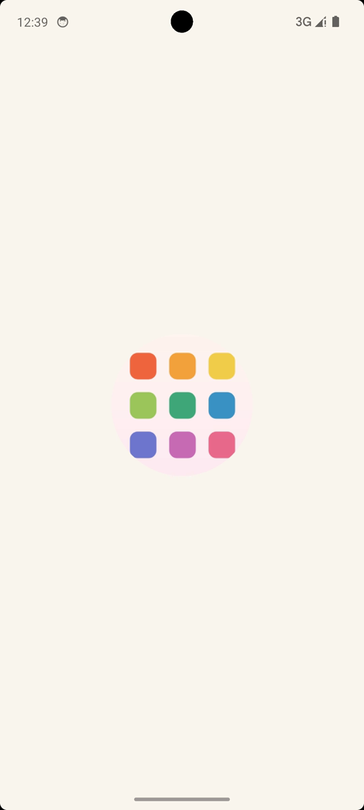 | 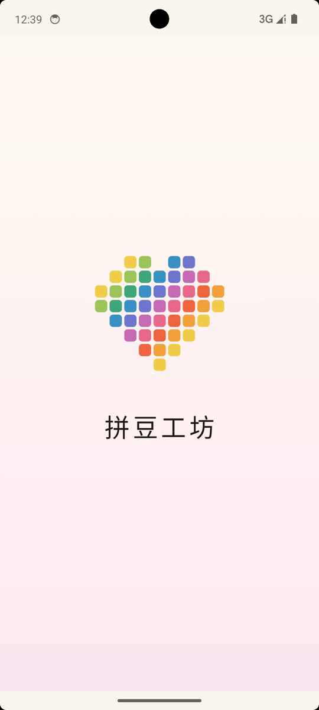 | 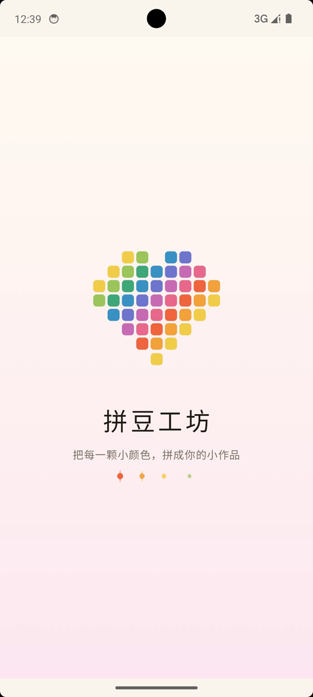 |

| 首页 | 创艺工坊 · 模板 | 创艺工坊 · 配色 |
|---|---|---|
| 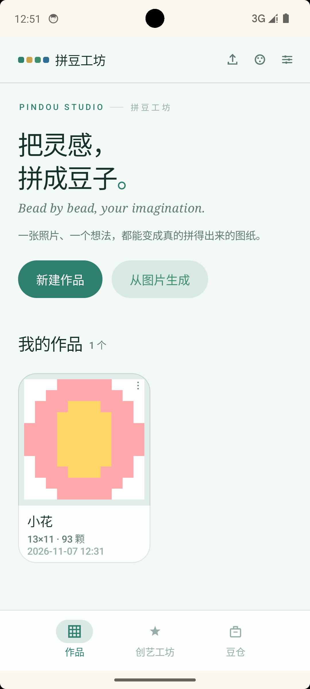 | 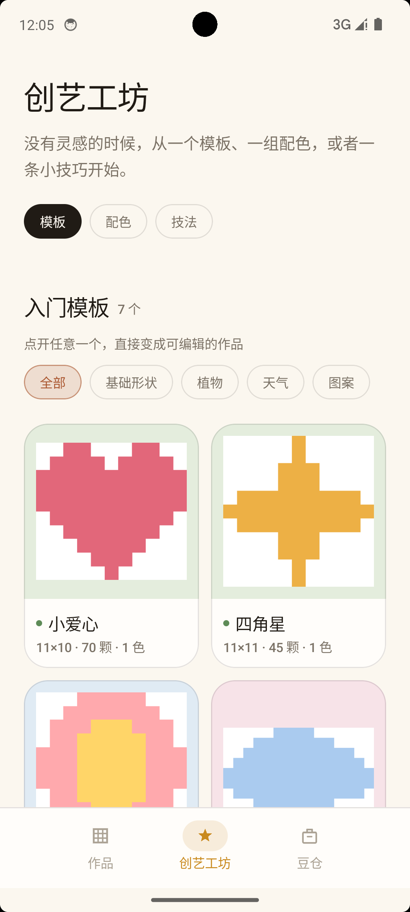 | 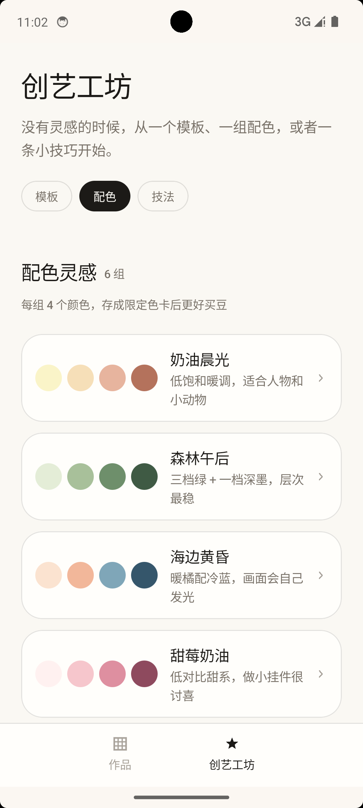 |

| 创艺工坊 · 技法 | 编辑器 | 调色板 |
|---|---|---|
| 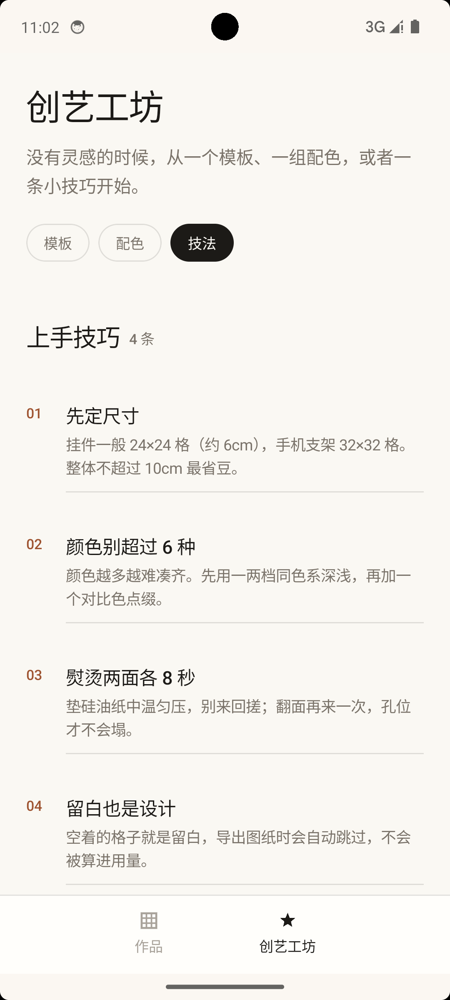 | 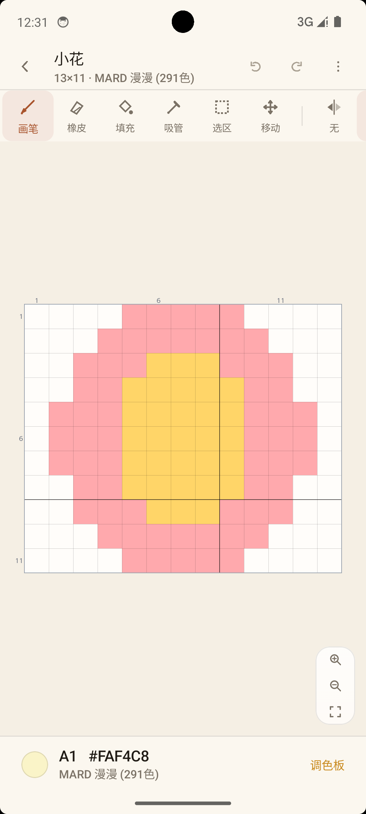 | 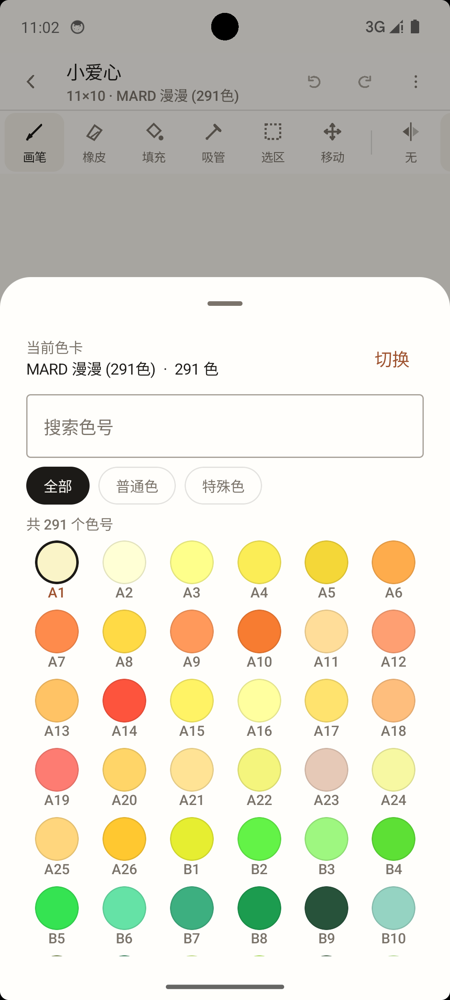 |

| 用量统计 | 以图生草图 | 新手指引 |
|---|---|---|
| 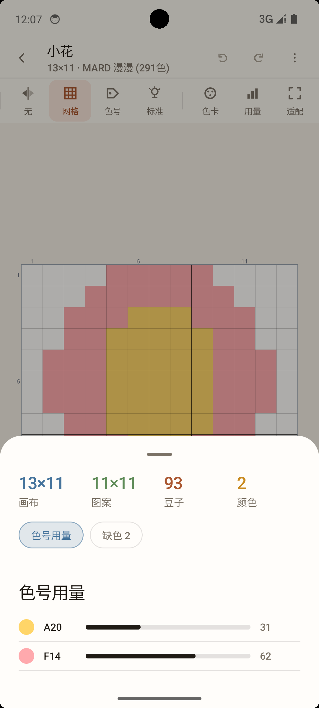 | 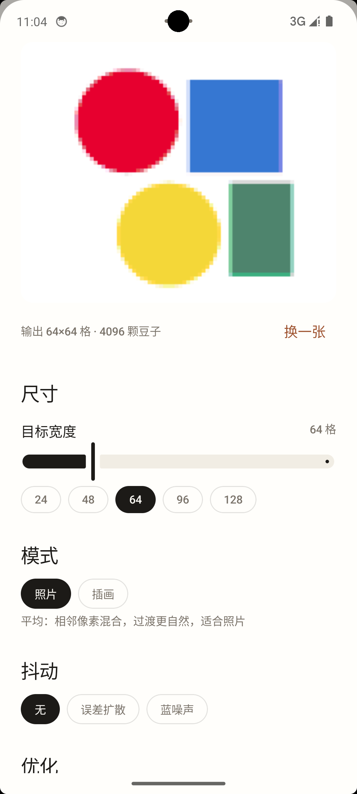 | 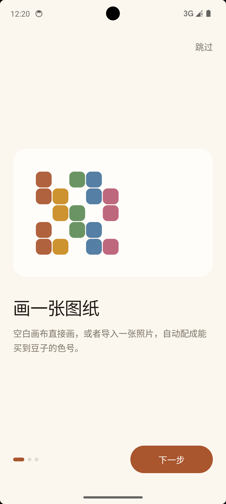 |

| 设置 · 五套配色 | 海盐主题 | 糖果主题 |
|---|---|---|
| 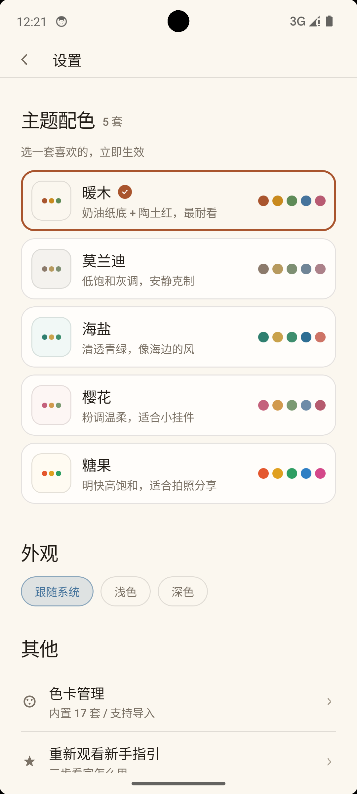 | 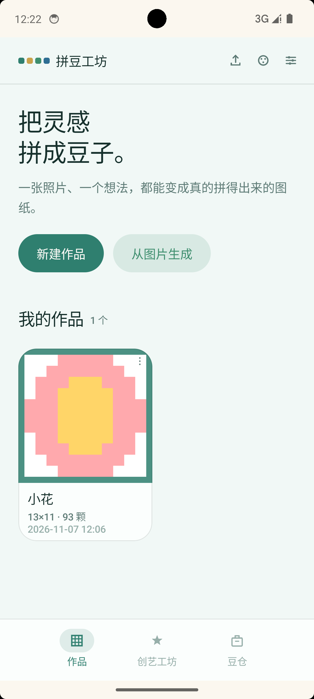 | 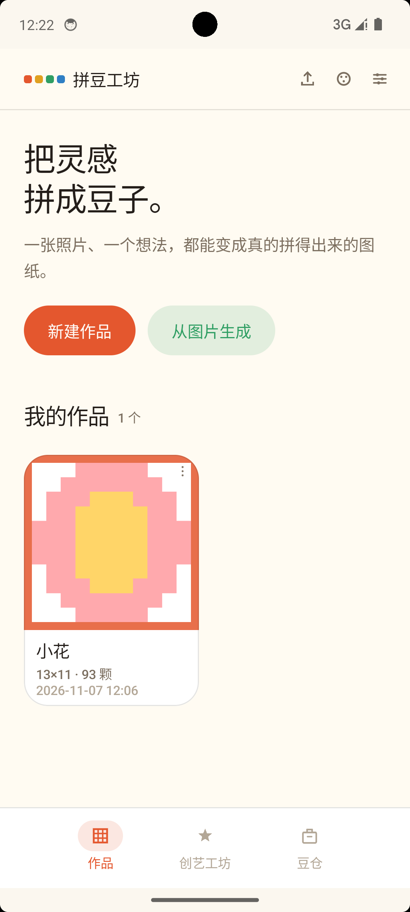 |

| 毛玻璃面板（底层虚化） |
|---|
| 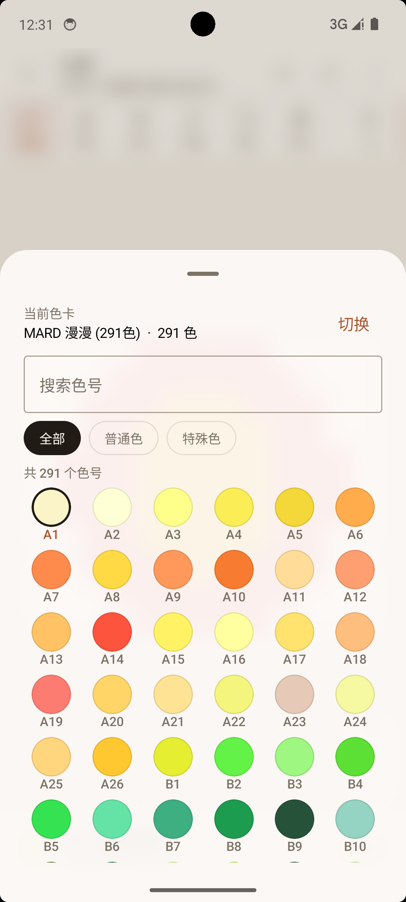 |

| 拼制工作台 | 豆仓 | 缺色检查 |
|---|---|---|
| 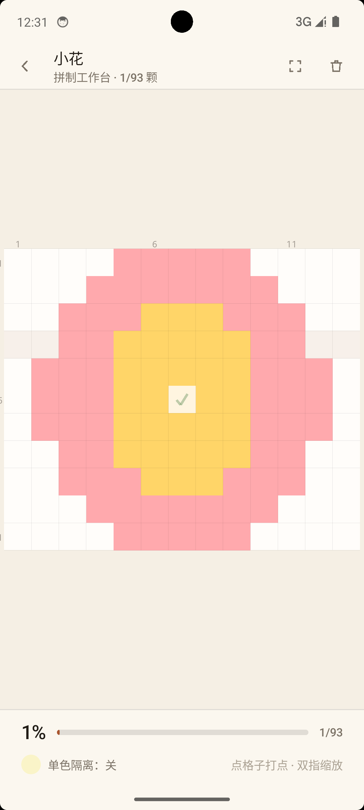 | 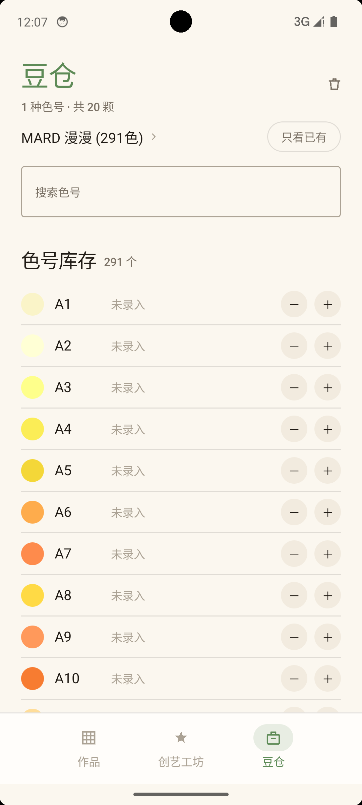 | 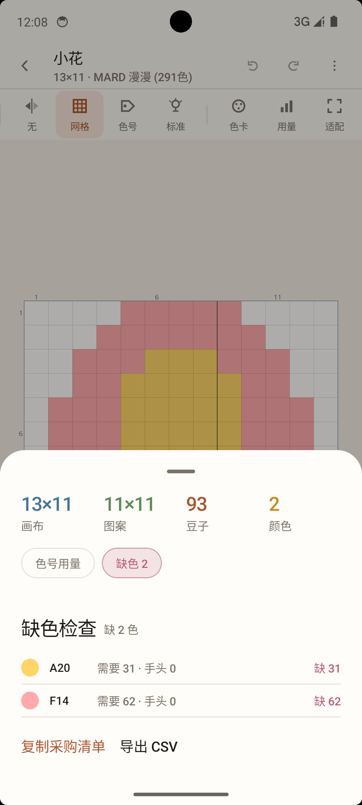 |

> 以上截图均来自 Android 14（API 34）模拟器实机运行。

---

## 功能一览

### 开屏动画
- 背景是奶油 → 樱粉的柔和渐变，和桌面图标同一套色彩语言
- **一把彩色豆子从画面外飞入**，按顺序落位拼成一颗 9×8 的彩豆爱心（每颗颜色都不同）
- 字标「拼豆工坊」带弹簧放大落定 → 副标「把每一颗小颜色，拼成你的小作品」淡入 → 底部亮起四颗彩色光点
- 收尾整体放大 1.08 淡出，直接露出首页（不做页面跳转，无闪烁）
- 全程约 2.2 秒，**任意点击可提前跳过**；只在冷启动播放一次

动画沿用 [splash_screen](https://github.com/laohei7/splash_screen) 的「分步状态机 + `updateTransition`」结构，
内容换成彩豆拼图 + 光点，并以浮层方式叠在真实界面之上。
### 创艺工坊
- **模板双模式**：点开模板先进**预览模式**（只读，能看尺寸 / 颗数 / 配色用量，不产生任何工程文件），
  需要改再切**编辑模式**（就地画笔 / 橡皮 / 填充 / 吸管 / 撤销 / 还原模板），
  改完点「保存为我的作品」才真正建工程并进入编辑器
- **入门模板 7 个**：小爱心 / 四角星 / 小花 / 云朵 / 彩虹条 / 棋盘格 / 波点，按**基础形状 / 植物 / 天气 / 图案**分类筛选，点开即变成可编辑的作品
  模板用「留白 + 色块」描述，颜色按 OKLab 就近匹配到当前色卡，任何一套色卡都能用
- **配色灵感 6 组**：奶油晨光 / 森林午后 / 海边黄昏 / 甜莓奶油 / 蜜桃汽水 / 苔原灰绿
  一键存成「限定色卡」，导入图片时只会用这几种颜色，买豆更容易
- **上手技巧 4 条**：尺寸选择、颜色数量、熨烫参数、留白原则
### 画布编辑器
- **画笔 / 橡皮 / 油漆桶 / 吸管 / 选区 / 移动画布** 六种工具
- 拖动绘制使用 **Bresenham 插值**，快速划动也不会断线
- **低缩放自动 LOD**：缩得很小时一次落笔覆盖一个色块，避免误触
- **撤销 / 重做**：笔画以补丁形式记录（省内存），整体操作记录快照，默认保留 80 步
- **对称绘制**：无 / 左右 / 上下 / 四向 / 对角
- **选区**：拖拽新增、拖动移动内容、填充、删除、复制 / 剪切 / 粘贴、全选
- **图像变换**：水平翻转、垂直翻转、顺时针 / 逆时针旋转
- **扩裁画布**：任意尺寸（上限 1024×1024），内容可左上对齐或居中
- **底图叠加**：导入参考图片，可调不透明度与缩放，贴合画布显示在豆子下方
- **缩放平移**：双指捏合以焦点缩放（1×–72× 像素/格）、单指拖拽平移（移动画布工具）、一键适配

### 显示
- **显示网格** / **每 8 格加粗主网格** / **显示色号** / **坐标尺** / **圆形豆子**
- **光效模式**：标准 / 夜间 / 温变 / 光变 / 特殊 —— 内置色卡里的 `light`、`temperatrue`、`glow`、`pearlescent`、`transparent` 类型都会按模式渲染对应颜色

### 以图生草图（本地完成，不上传）
- **照片模式（平均）**：每格像素取平均值，过渡自然
- **插画模式（主色）**：每格取出现最多的颜色，色块锐利
- **抖动**：无 / Floyd–Steinberg 误差扩散 / 蓝噪声
- **合并相近色**：按 OKLab 距离把低频颜色并入高频颜色
- **移除背景**：从四边泛洪清除背景主色
- **排除色号**：指定某些色号不参与匹配
- **色彩调整**：亮度 / 对比度 / 饱和度
- 实时预览，目标宽度 8–256 格可调

### 毛玻璃与动效

**玻璃质感**
- 底部面板（调色板 / 用量 / 以图生草图 / 导出 / 模板 / 配色）打开时，**底层界面实时虚化**（`Modifier.blur`，面板关闭再弹回清晰），面板本身用 88% 半透明白 + 轻遮罩，能透出底下的颜色
- 画布上的浮动控件（缩放、选区操作条、底图提示）统一走 `GlassSurface`：半透明表面 + 顶部一道高光 + 1px 描边，无阴影
- API 31 以下不支持真实模糊，会自动退化成「半透明 + 描边」，观感仍然成立

**动效**（全部用 spring 曲线，参数集中在 `Motion`）
| 位置 | 动作 |
|---|---|
| 页面切换 | 进编辑/工作台/设置：淡入 + 自下而上滑入；切 Tab：交叉淡入 |
| 底部导航 | 选中项：胶囊底色放大淡入（spring）+ 图标弹一下 + 文字变色（220ms） |
| 按钮 / 胶囊 / 卡片 | 按下缩到 0.94–0.975 再弹回（`pressScale`） |
| 工具栏 | 选中的工具：浅底渐显 + 图标放大 1.06（spring） |
| 列表 | 作品卡、模板卡按序号错开 55ms 依次淡入上浮 |
| 工作台进度 | 打点时进度条弹性推进 |
| 开屏 | 豆子落位用 spring 回弹，字标上浮、细线拉开 |
### 主题配色（5 套，可切换）
- 设置页里挑一套，**即时生效**并记住选择；三套浅色 + 各自对应的深色版本

| 主题 | 底色调性 | 五个功能色 |
|---|---|---|
| 暖木 | 奶油纸 + 陶土红，最耐看（默认） | 陶土 / 琥珀 / 草绿 / 天蓝 / 玫瑰 |
| 莫兰迪 | 低饱和灰调 | 灰棕 / 灰金 / 灰绿 / 蓝灰 / 灰玫瑰 |
| 海盐 | 清透青绿 | 松绿 / 沙金 / 海绿 / 深海蓝 / 珊瑚 |
| 樱花 | 粉调温柔 | 樱粉 / 杏橘 / 松绿 / 雾蓝 / 玫红 |
| 糖果 | 明快高饱和 | 橘红 / 明黄 / 翠绿 / 亮蓝 / 洋红 |

深色模式可单独设「跟随系统 / 浅色 / 深色」，与主题独立组合。

### 新手指引（三步）
- 首次启动自动出现，**一屏一步、右上角随时跳过**，全程不到 10 秒
- 三步分别是：画一张图纸 → 边拼边打点 → 管住豆仓，每步配一张用代码画的小图
- 设置 →「重新观看新手指引」可随时重看
### 拼制工作台（核心特色）
- **进度打点**：点格子标记已拼，已拼格子淡出并打勾，剩下的清晰可见；再点取消
- **行列辅助**：高亮最近一次点到的行与列，方便对着图纸找格
- **单色隔离**：只看当前要拼的颜色，方便从豆仓里挑豆
- **屏幕常亮** + 双指缩放 + 单指拖动 + 一键适配
- 进度按工程持久化（Base64 + GZIP + varint 存已拼下标），退出重进不丢

### 豆仓库存
- 按色卡录入手头每种色号的颗数（− / + 按 10 递增，点行可精确填数，支持 +50 / +100 / +500）
- 支持搜索、只看已有、切换色卡；跨色卡同名色号视为同一种豆
- 数据存在 files/inventory.json，完全离线

### 缺色检查与采购清单
- 打开任意图纸，自动比对豆仓：列出「需要 / 手头 / 缺多少」
- 一键**复制采购清单**纯文本（可直接粘到聊天或购物车），或导出 CSV
- 豆仓为空时给出引导，不打扰
### 色卡
- 内置 **17 套色卡、共 2960 个色号**：
  MARD 漫漫 / Perler / Artkal / Hama / DMC / Coco 可可 / MARD 24·48·72·96·120·144·221·295 / 卡卡家 / 漫漫家 / 盼盼拼豆
- 搜索色号、按普通色 / 特殊色筛选
- **导入自定义色卡**：兼容 pindou-draw 的 JSON（`{"A1":{"color1":"rgb(...)"}}`）与 CSV（`num,type,color1,color2`），也支持直接粘贴文本导入
- **切换色卡自动换色**：按色号同名映射，缺失色号按 OKLab 就近取色
- 用户色卡保存在应用私有目录，可随时删除

### 用量统计
- 画布尺寸 / 实际图案尺寸 / 豆子总数 / 颜色数
- 每个色号的用量与占比条形图

### 导出
- **PNG 打印图纸**：白色背景、四周行列坐标、可选色号标签、每 8 格加粗主网格、底部用量统计
- **分块导出**：整张 / 4 张 / 9 张 / 16 张
- 每格像素 8–64px 可调
- **PDF 打印图纸**：A4 @150dpi 单页自适应（用系统 PdfDocument，无第三方库），带标题、坐标、色号、用量表
- **SVG 矢量图纸**：同色相邻格自动合并成长条，缩放打印不失真
- **用量清单 CSV**：色号 + 数量 + 合计，方便按需求购买豆子
- PNG 保存到相册 `Pictures/拼豆工坊`，或直接分享；SVG / CSV 保存到 `Download/拼豆工坊`

### 工程文件
- 自动保存（防抖 700ms）+ 退出时保存
- 作品列表带缩略图、尺寸、豆子数、修改时间
- 重命名 / 创建副本 / 删除
- **导入 / 导出 `.pdp`**（本应用原生格式，含色卡快照）
- **导入 / 导出 `.pd`**（兼容 pindou-draw 网页版，可双向交换）

---

## 设计语言

界面遵循 https://github.com/Leonxlnx/taste-skill 的克制原则（anti-slop），落成一套可直接复用的 token：

| 维度 | 规则 |
|---|---|
| 色彩 | 底色是暖纸 `#FBF7EF`，文字用暖墨 `#201B15`（不用纯黑）；在此之上用**五个拼豆色**做功能色：陶土 `#A9552E`（创作）、琥珀 `#C98A1E`（创艺工坊）、草绿 `#5E8B57`（豆仓）、天蓝 `#46749C`（画布数据）、玫瑰 `#B85B72`（缺色提醒），每个都配一层同色浅底 |
| 用色规则 | 文字始终中性，彩色只出现在按钮、图标、选中态、数据数字和浅色块上；底部导航每个分区一种颜色（作品 / 创艺 / 豆仓），一点就换色 |
| 排版 | 首屏用编辑式双语排版：全大写宽字距小标（`PINDOU STUDIO —— 拼豆工坊`）+ 34sp 紧字距中文主标题（句号点强调色）+ 衬线斜体英文副标，三种字体语言拉开层次 |
| 文案轮播 | 首屏主标题是 10 条围绕创造力的双语文案池（`ui/home/HeroCopy.kt`），每 10 秒随机切下一条，不连续重复；切换用 420ms 淡入 + 1/3 高度上滑，两条文案高度一致所以版面不跳 |
| 质感 | 层次只靠「半透明 + 1px 描边 + 底层虚化」表达，全应用零阴影；动效统一 spring 曲线 |
| 主题 | 上面这套色板不是写死的：内置 **5 套主题**（暖木 / 莫兰迪 / 海盐 / 樱花 / 糖果），在设置里一键切换，深浅色各自成对 |
| 描边 | 用 12% 墨色的 **1px 描边**表达层级，全应用 **零阴影** |
| 字阶 | 单一字族，只 400 / 500 两个字重：32 / 22 / 17 / 16 / 14 / 13sp，**最小 13sp**，大字号用 -0.6sp 字距收紧代替加粗 |
| 圆角 | 只有三档：卡片 24、面板 16、控件 10，按钮为胶囊；每一层内嵌都按「外圆角 − 内缩」重新取圆角，层层同心（卡片 24 → 画框 16 → 白画板 8），任何一层都不留直角 |
| 间距 | 只用 4 / 8 / 12 / 16 / 24 / 32 / 48；页面左右边距统一 24dp，所有板块共用同一条边线 |
| 按钮 | 全应用两种：填充陶土主按钮（每个视图最多一个）+ 浅底彩色次按钮（TintedButton，按语义取色）；其余为纯文字链接 |
| 结构 | 一个系统贯穿到底：一种卡片、一种分隔线、一种选中态（墨色填充），不出现第二套 |

---
## 技术栈

| | |
|---|---|
| 语言 | Kotlin 2.0.21 |
| UI | Jetpack Compose + Material 3 |
| 画布 | Compose `Canvas` + `android.graphics.Canvas` 直接绘制（无第三方渲染库） |
| 图形 | `android.graphics.Bitmap` / `Canvas` 生成导出图纸 |
| 序列化 | kotlinx.serialization（JSON） |
| 存储 | 应用私有目录 JSON + 缩略图 PNG，SharedPreferences 存设置 |
| 构建 | Gradle 8.9 + AGP 8.7.3 |
| 最低版本 | Android 7.0 (API 24)，目标 API 34 |

无网络依赖、无第三方 SDK、无统计分析。

---

## 目录结构

```
pindou-android/
├── app/src/main/
│   ├── assets/palettes.json              # 内置 17 套色卡（2960 色）
│   ├── java/com/pindou/studio/
│   │   ├── MainActivity.kt               # 单 Activity + Compose 导航
│   │   ├── PindouApp.kt                  # Application，持有各仓库
│   │   ├── core/                         # 纯业务逻辑（可单测）
│   │   │   ├── ColorMath.kt              # 十六进制解析、sRGB↔OKLab、色差、色彩调整
│   │   │   ├── Palette.kt                # 色卡 / 颜色模型
│   │   │   ├── BeadGrid.kt               # 稠密网格：绘制、泛洪、翻转、旋转、扩裁、统计
│   │   │   ├── GridHistory.kt            # 撤销栈（补丁 + 快照两种记录）
│   │   │   ├── Quantizer.kt              # 以图生草图：降采样→代表色→最近色→抖动→合并→去背
│   │   │   ├── PatternTemplates.kt       # 创艺工坊模板 / 配色 / 技巧数据
│   │   │   ├── PdfExporter.kt            # A4 PDF 打印图纸
│   │   │   ├── ShoppingList.kt           # 采购清单文本 / CSV
│   │   │   ├── ChartExporter.kt          # PNG 图纸渲染（坐标/色号/主网格/用量/分块）
│   │   │   ├── EditorTypes.kt            # 工具、对称、显示模式、选区
│   │   │   └── Project.kt                # 工程模型
│   │   ├── data/                         # 数据层
│   │   │   ├── Dtos.kt / Codec.kt        # 序列化模型与 Base64+GZIP 网格编码
│   │   │   ├── PaletteRepository.kt      # 内置 / 用户色卡，JSON·CSV 解析
│   │   │   ├── ProjectRepository.kt      # 工程读写、缩略图
│   │   │   ├── PdFormat.kt               # pindou-draw .pd 互转
│   │   │   ├── InventoryRepository.kt    # 豆仓库存（inventory.json）
│   │   │   └── AppSettings.kt            # 设置
│   │   ├── ui/
│   │   │   ├── splash/                   # 开屏动画（豆子落位 → 字标 → 细线）
│   │   │   ├── onboarding/               # 三步新手指引
│   │   │   ├── settings/                 # 设置：主题配色 / 外观 / 其他
│   │   │   ├── home/                     # 首页：我的作品
│   │   │   ├── workshop/                 # 创艺工坊：模板 / 配色 / 技法
│   │   │   ├── editor/                   # 编辑器：画布、工具栏、六个底部面板
│   │   │   ├── workbench/                # 拼制工作台：打点、单色隔离、行列辅助
│   │   │   ├── inventory/                # 豆仓：色号库存录入
│   │   │   ├── palette/                  # 色卡管理
│   │   │   ├── components/               # 设计系统控件 + 代码绘制的图标集
│   │   │   └── theme/                    # Ds 设计 token + PindouThemes 五套配色
│   │   └── util/FileUtils.kt             # 相册保存、分享、采样解码
│   └── res/                              # 图标、主题、FileProvider 配置
├── app/src/test/                         # 核心逻辑单元测试（21 项）
├── screenshots/                          # 实机截图
└── tools/gen-palettes.js                 # 从两个参考项目生成 assets/palettes.json
```

---

## 构建

### 方式一：Android Studio（推荐）
用 Android Studio 打开 `pindou-android` 目录，等待 Gradle 同步完成后：
- 运行：`Run 'app'`
- 打包：`Build → Generate Signed Bundle / APK`

### 方式二：命令行
需要 JDK 17+ 与 Android SDK（compileSdk 34 / build-tools 34.0.0）。

```bash
# 调试包
gradle assembleDebug
# 正式签名包
gradle assembleRelease
```

产物：
- `app/build/outputs/apk/debug/app-debug.apk`
- `app/build/outputs/apk/release/app-release.apk`

> 注意：工程路径含中文时，AGP 需要 `android.overridePathCheck=true`（已在 `gradle.properties` 中配置）。
> 但 **JUnit 单元测试在含中文的路径下无法加载测试类**，如需运行 `gradle test` 请先把工程复制到纯英文路径。

签名：工程内已附带演示用的 `app/pindou-release.jks`（storepass / keypass：`pindou2024`，alias：`pindou`）。
正式上架请替换成你自己的 keystore 并修改 `app/build.gradle.kts` 里的 `signingConfigs.release`。

---

## 快速上手

1. 首页点 **新建作品** → 填名称、宽高（格）、选色卡 → 创建
2. 或者点 **从图片生成** → 选一张图 → 调目标宽度与模式 → **应用到画布**
3. 底部导航切到 **创艺工坊** → 挑一个模板直接变成作品，或把一组配色存成限定色卡
4. 底部栏点击色卡色块打开调色板，选颜色后直接在画布上画
5. 右上角 **⋮** 菜单：以图生草图、导入底图、画布尺寸、显示设置、导出图纸、图像操作、清空画布
6. 双指捏合缩放、单指拖动绘制、切换到「移动」工具后单指拖动可平移画布
7. 导出时勾选「显示色号」「坐标编号」「用量统计」，按打印需要选分块数量

---

## 与《拼豆手工辅助安卓 APP 产品调研与规划》的对应关系

| 规划中的 MVP 条目 | 当前实现 |
|---|---|
| 空白画布绘制（自定义尺寸 / 画笔 / 橡皮 / 油漆桶 / 吸色 / 撤销重做 / 对称） | 已完成；尺寸 1–1024，支持标准板尺寸预设，对称 5 种模式 |
| 图片转图纸（相册导入 / 去背景 / 像素化降色 / 相近色合并 / 多品牌色卡） | 已完成；相册导入 + OKLab 就近匹配 + 平均/主色 + 误差扩散/蓝噪声抖动 + 合并相近色 + 移除背景 + 排除色号 |
| 模板库（分类筛选、可二次编辑） | 已完成 7 个模板，按基础形状 / 植物 / 天气 / 图案分类，可一键转成工程后任意修改 |
| 网格视图 / 色号标注 / 单色隔离 | 已完成（单色隔离同时在工作台提供） |
| 自动统计每种颜色用量 | 已完成（用量面板 + 占比条） |
| **拼制工作台**（局部放大 / 常亮 / 行列辅助 / 进度打点） | **已完成**，并额外提供单色隔离与进度持久化 |
| 本地草稿 / PNG 导出 / PDF 打印 / 文字采购清单 | 已完成 PNG、PDF（A4）、SVG、CSV 采购清单；云端备份未做（产品定位离线优先） |
| **豆仓库存 + 缺色预警 + 采购数量计算** | **已完成**，跨色卡同名色号合并统计 |
| 系统设置（色卡切换 / 深色模式 / 新手引导） | 已完成色卡切换、跟随系统深色模式、首次启动三步引导 |

尚未实现（属规划中的二期）：立体分层图纸、社区、纸质图纸 OCR、作品相册、云同步。

---
## 与参考实现的对应关系

| 参考实现 | 本应用实现 |
|---|---|
| `transform.ts` 的 OKLab 最近色 + 平均/主色 + 合并相近色 + 去背 | `core/Quantizer.kt` |
| `photo-sketch.js` 的 Floyd–Steinberg / 蓝噪声抖动 | `core/Quantizer.kt`（`distributeError` / 蓝噪声矩阵） |
| `editor.ts` 的 paintBlock / walkLine / floodFill / 用量统计 | `core/BeadGrid.kt` + `EditorViewModel.paintAt` |
| `export.ts` 的坐标带、色号、主网格、用量表、分块 | `core/ChartExporter.kt` |
| `pd.js` 的 .pd 工程结构 | `data/PdFormat.kt` |
| `state.js` 的显示模式（standard/night/light/temperature/special） | `core/EditorTypes.kt` `DisplayResolver` |
| `highlight-outline.js` 的选区 | `EditorViewModel` 选区模块（拖拽/填充/删除/复制粘贴） |
| `symmetry.js` 对称绘制 | `EditorViewModel.forEachSymmetry` |
| `color-maker.js` / `palette.js` 色卡 JSON·CSV 格式 | `data/PaletteRepository.kt` |

未移植的部分（依赖服务端或非移动场景）：
- 图纸画廊 / GitHub 登录 / 发布分享（pindou-main 的服务端能力）
- 在线自动更新、多语言界面（本应用为简体中文）

---

## 真机 / 模拟器验证记录

在 **Android 14 (API 34) x86_64 模拟器**（Pixel 6 规格，1080×2400）上完成以下端到端验证：

| 验证项 | 结果 |
|---|---|
| 冷启动 / 桌面图标 / 启动页 | 正常 |
| 首页布局、空状态、作品卡片 | 正常 |
| 新建作品对话框（名称 / 宽高 / 预设 / 色卡选择） | 正常 |
| 画布渲染（豆子、网格、每 8 格主网格、坐标尺） | 正常 |
| 单指点按与拖动绘制（Bresenham 连线） | 落笔位置与连线正确 |
| 调色板选色 → 落笔颜色切换 | 选 A4 后新笔画为 A4 色 |
| 撤销 / 重做 | 撤销清空、重做完整还原 4096 格 |
| 以图生草图（照片 / 插画模式、实时预览、应用到画布） | 480×480 测试图转 64×64 / 4096 颗 / 5 色 |
| 光效模式切换（标准 → 夜间） | 画布整体压暗 |
| 用量统计面板（尺寸 / 总量 / 每色占比） | 数据与画布一致 |
| 导出 PNG 图纸（坐标 + 色号 + 用量统计） | 保存至 Pictures/拼豆工坊，图纸内容正确 |
| 导出 SVG 矢量图 | 保存至 Download/拼豆工坊，结构合法 |
| 导出用量清单 CSV | 表头 色号,数量 + 合计，数值正确 |
| 导出 .pd 工程（pindou-draw 兼容） | version 2 / canvas / 291 色 palette / 64×64 色号网格 |
| 导入 .pd 工程 | 还原 64×64 / 4096 颗，5 色用量与原图完全一致 |
| 自动保存与重启后恢复 | 卸载重装后作品仍在列表 |
| 主题切换（暖木 / 莫兰迪 / 海盐 / 樱花 / 糖果） | 即时生效，重启后保持；深浅色各自成对 |
| 三步新手指引（跳过 / 下一步 / 开始使用） | 三屏内容与插图正常，完成后不再自动弹出，可从设置重看 |
| 毛玻璃面板（打开调色板时底层虚化） | 面板半透明、背景模糊、关闭后恢复清晰 |
| 新开屏（彩豆飞入 → 爱心 → 字标 → 光点） | 录屏逐帧核对：45 颗豆子依次落位，爱心形状正确 |
| 新图标 / 空态彩豆插画 | 桌面图标为渐变底 + 九颗彩虹豆；空态显示彩豆爱心 |
| 双语首屏排版 | 小标 / 主标题 / 英文斜体副标三级层次清晰，句号强调色正常 |
| 动效（页面切换 / 按压 / 选中弹跳 / 列表入场 / 进度弹性） | 实机逐项确认流畅，无掉帧卡顿 |
| 崩溃检查（logcat crash buffer） | 全程无崩溃 |
| 新版界面（暖纸底 / 单强调色 / 零阴影 / 底部导航） | 七个页面实机截图核对通过 |
| 开屏动画 | 录屏逐帧核对：豆子落位 → 字标 + 细线 → 淡出 → 首页，无「Viewing full screen」系统提示 |
| 创艺工坊 · 模板（7 个） | 预览正常，点开可新建作品，颜色按 OKLab 落到当前色卡 |
| 创艺工坊 · 配色（6 组） | 就近色号匹配正常，可存为限定色卡 |
| 创艺工坊 · 技法（4 条） | 排版与分隔线正常 |

另外 27 项 JVM 单元测试覆盖网格绘制 / 泛洪 / 旋转翻转 / 扩裁 / 色号往返 / 调色板查找 /
撤销重做（补丁与压缩快照，含快照不持有画布数组、压缩率、内存预算淘汰）/ OKLab 色差 /
SVG 与 CSV 导出 / .pd 读写往返与无色卡回退 / 创艺工坊模板与配色的数据合法性
（含模板 id 唯一、基础形状模板完整），全部通过。

> 中文路径下 `gradle test` 会报 `ClassNotFoundException`（JVM 类加载受非 ASCII 路径影响）。
> 验证方式：把工程复制到纯英文路径再跑，或直接用 `./gradlew`（工程已带 wrapper）。

### 复现验证环境

```bash
sdkmanager "emulator" "system-images;android-34;google_apis;x86_64"
avdmanager create avd -n pindou34g -k "system-images;android-34;google_apis;x86_64" -d pixel_6
emulator -avd pindou34g -no-window -gpu swiftshader_indirect
adb install -r dist/拼豆工坊-v1.0.0-release.apk
adb shell am start -n com.pindou.studio/.MainActivity
adb emu screenrecord screenshot shot.png     # 无窗口模式下用模拟器控制台截屏
```

> 提示：AOSP ATD 精简镜像虽然能跑，但截图始终全黑（无合成器输出），验证 UI 请用 google_apis 镜像。

---

## 版本

v2.19.3 — **99 款字体全部打包**：完整字库改为默认（`-PpindouFullFonts=false` 可切回精选 42 款的精简版），字体选择器里共 102 款（99 内置 + 系统黑/宋/等宽）；代价是 APK 从 36MB 涨到 **305MB**（字体 470MB 压缩后）

v2.19.2 — 修 MIX 的**跨色卡丢色**：原来把上层强行映射进下层的色卡，下层若只有 3 个颜色（如「小花」的粉/黄），上层「拼豆工坊」的紫/品红就会被"就近"吃掉。现在改为 `LayerMixer.mergePalettes` **合并两套色卡**（下层原样打底、索引不变；上层独有的色号追加在后面），两张图的颜色都完整保留

v2.19.1 — 修长按冲突：**长按彻底让给 MIX 拖拽**（不再弹「看大图」预览框，长按不动只给一句用法提示、也不会误跳转），「看大图」挪到卡片 ⋯ 菜单里；顺带吞掉长按松手后卡片自身触发的那次点击

v2.19.0 — 新玩法 **MIX 叠加**：在「我的作品」把一张作品**长按拖到另一张上**（或卡片 ⋯ →「叠加到另一个作品（MIX）」再点目标）就进入合成工作台——上下层可一键互换、上层透明度 0–100%（用 4×4 Bayer 抖动模拟半透明）、**蒙版画笔**（擦除 / 恢复 / 反相 / 清空）控制上层露出哪儿；「生成作品」直接得到一张新图纸。合成内核 `core/LayerMixer.kt` 纯逻辑可单测（尺寸不同自动居中、跨色卡自动重映射）

v2.18.1 — 字体 DIY **不再自动折行**：一行要多长就多长，只有用户在输入框里敲回车才分行（`TextSpec.maxCols` 默认 0 = 不折行；避头尾逻辑只在显式设了上限时生效）；一行超出单张画布（1024 格）时给出明确提示并禁用生成，同时清掉上一次的掩膜，避免"生成了旧图"

v2.18.0 — **字体库扩充 + 字体选择器重做**：字体从 6 款扩到 45 款（12 中文 + 30 英文 + 3 系统），全部做 GB2312 子集化（原始 768MB → 子集 468MB，入包 41MB），**APK 反而从 54MB 降到 36MB**；新增字体选择器（搜索 / 分类 / 所见即所得预览 / 最近使用 / 惰性加载 + Typeface LRU ≤6 / 英文款标「仅英文」），「字形」区域改成「当前字体 + 更换」，不再铺一排 chip；支持从手机导入 .ttf/.otf；其余 57 款留在 `fonts-full/`，`./gradlew assembleRelease -PpindouFullFonts=true` 可构建 99 款完整版

v2.17.7 — ①**「确认才保存」推广到作品编辑器**（全局规则）：编辑器不再 700ms 自动落盘，顶栏出现「保存 / 已保存」状态按钮与「未保存 ·」提示，返回或系统返回若有未保存改动会弹「保存并退出 / 放弃修改 / 继续编辑」，ViewModel 销毁时也不再偷偷补存；②**所有界面切换都加了过渡动画**：按深度判断方向，进入下一层淡入 + 上浮、返回上一层淡入 + 下落，Tab 之间与模板页也一并覆盖（以前是硬切）

v2.17.6 — 模板编辑改成「必须确认才保存」：编辑中的改动不再有任何自动落盘，「保存为我的作品」是唯一确认口；返回 / 系统返回若有未保存改动会弹「还有没保存的修改」（放弃修改 / 继续编辑 / 保存为作品）；有改动时底栏次按钮变成「放弃修改，返回预览」并配橙色提示。顺带修掉一个真 bug——模板编辑用的网格和「模板原图」曾是**同一个对象**，画笔直接改在基准图上，导致"是否有改动"永远判不出来、退出也从不提示

v2.17.4 — 编辑态减负 + 全屏改手动翻转：工具栏只留「画笔 / 橡皮 / 填充 / 吸管 / 选区 / 移动 + 对称」（网格、色号、光效收进「显示设置」，色卡/用量/适配分别走底部色条、⋮ 菜单和右下浮动缩放条，不再横向滚动）；⋮ 菜单从 14 项精简到 6 项（开始拼制 / 导出图纸 / 用量统计 / 显示设置 / 全屏查看 / 更多编辑操作… / 放弃作品），其余编辑动作收进新的「更多编辑操作」底部面板（以图生草图、导入或更换底图、画布尺寸、图像操作、清空画布、返回预览）；全屏看图去掉「锁定」，改成**手动「翻转」**（点一次图纸转 90°，0/90/180/270），方向仍然钉在进入那一刻不会自己翻

v2.17.3 — 修全屏看图会跟着重力横竖翻转的问题：进全屏时把屏幕方向**钉在进入那一刻**（SCREEN_ORIENTATION_LOCKED），退出全屏恢复跟随系统；右上新增**手动「横屏 / 竖屏」**按钮（转完仍钉住，不会自己转回去，转屏后自动重新适配）；「锁定」的含义统一为**冻结画面 + 冻结方向**，提示条也写清楚

v2.17.2 — 「预览 / 编辑」从模板推广到**全部图纸入口**：打开「我的作品」里的作品也先进**只读预览**（顶栏「预览·只读」角标、无工具栏、单指拖动只平移画面、双指缩放），底部才有「进入编辑」与「全屏查看」；新建 / 图片转图纸 / 模板保存 / 工坊生成后进入的仍是编辑态（不打断原来的动线）。全屏看图抽成公共组件 `FullScreenPatternViewer`，模板与作品共用同一套「退出全屏 / 锁定」；编辑器菜单按模式拆分，预览态只留「开始拼制 / 显示设置 / 导出 / 全屏 / 放弃作品」，改图类功能一律收进编辑态

v2.17.1 — 模板页按验收意见重做交互：**预览模式彻底只读**（画布不接手势、无任何编辑控件，顶栏常驻「预览 · 只读」角标），改图必须先点底部**「进入编辑」**；编辑模式底部是「返回预览」+「保存为我的作品」；预览新增**全屏查看**（沉浸式隐藏系统栏、双指缩放单指拖动、超范围自动夹住），全屏内提供**退出全屏**与**锁定**（锁定后画面不再跟手，适合照着拼）；顺带补了 Lock / Expand 两个图标

v2.17.0 — 按用户反馈做的体验升级：**模板改成「预览 / 编辑」双模式**（打开模板默认进预览，只读看尺寸 / 配色 / 用量，不产生工程；切到编辑可以就地画笔 / 橡皮 / 填充 / 吸管 / 撤销，改完「保存为我的作品」才建工程）；**「我的作品」加收藏与筛选**（全部 / 收藏 / 未完成 / 已导出，卡片上点星即收藏）；**回收站入口常驻**（以前只有回收站非空才出现，删完找不到）；**新建尺寸预设改成 29 / 52 / 78 / 104 等常见底板尺寸**；**首屏主按钮换成「图片转图纸」**；**以图生图 / 字体DIY 自动记住上次参数**（含热门配色一键套用）；**修复底图看不见的真 bug**（原来底图先画、再被不透明的画布底整块盖住，只有溢出画布外的一圈可见；现在画在画布底之上并裁到画布内，100% = 铺满画布）；**单色隔离对比度重做**（中性底板色 + 目标色号描边，低饱和色也看得清）；编辑器新增「放弃本次作品（移入回收站）」；对称绘制与光效模式都会用一句话解释当前含义，光效面板还会告诉当前色卡有几个特殊色号；模板库补了三张基础形状（爱心 / 星星 / 笑脸）

v2.16.0 — 存储与内存四条硬伤修复：①**原子保存**（tmp + fsync + rename，旧文件留 `.bak`，主文件损坏时自动回退并隔离成 `.corrupt`，不再有「写到一半变空工程」）；②**保存快照化**（主线程拍不可变 `ProjectPayload`，IO 线程落盘，彻底消除保存协程遍历 `HashSet` 与主线程增删的并发修改；退出编辑器后的收尾写入交由仓库自己的 IO 作用域，不会被取消）；③**撤销快照压缩**（快照 deflate 存储 + 24MB 字节预算，1024² 画布 80 步历史的峰值从理论 160MB 降到几 MB）；④**编辑器 ViewModel 生命周期收口**（编辑流独占一个 `ViewModelStore`，离开编辑器 400ms 后整份清掉，不再每开一个作品就漏一份网格 + 历史 + 底图）；顺带把主线程磁盘 IO 全部下到 IO 线程（打开工程 / 首页列表 / 导入导出 / 底图压缩），内置色卡不再抄进每份工程（单次保存从 ~270KB 降到几 KB），工程带 Gradle Wrapper

v2.15.1 — 「以图生图」面板改成三段式：预览固定在顶部（148→150dp 紧凑版）、参数区独立滚动、「应用到画布 / 取消」固定在底部，往下滑不会再看不到预览

v2.15.0 — 新增参数预设（字体 DIY 与以图生图各一套）：点「＋ 存为预设」命名保存、点预设一键套用、长按预设删除，持久化在 shared_prefs；修复调参时预览不实时——原来每次改动都会把 140/160ms 防抖任务重置，拖动过程中预览永远等不到执行，现在改成 snapshotFlow + conflate，只渲染最新一次参数，字体 DIY 还会先出 2× 速写图再补精细图

v2.14.0 — 「以图生图」参数面板同步重做：全部换成 BeadSlider 并按「尺寸 / 取色模式 / 配色 / 优化 / 影调」分组卡片；新增三个可调项——色数上限（0~24，超出后把相近色并入最常用色，方便按色采购）、伽马（0.5~2.0 提亮/压暗中间调）、去杂点（孤立单格并入周围主色）；ParamGroup 抽成公共组件，字体 DIY 与以图生图共用

v2.13.2 — 应用图标换成正式 LOGO（拼豆工坊APPLOGO.png）：启动器前景为该图缩进安全区后的透明位图，图标底板与闪屏/窗口底色统一取 LOGO 四角平均色 #FAF3EC，设置页「关于」也换成这枚 LOGO

v2.13.1 — 恢复开场动画：系统闪屏重新显示品牌图标，随后衔接应用自绘的「黑豆→逐字母上色→文字抹开」动画（含四角水彩绽开），点击可跳过

v2.13.0 — 字体 DIY 参数面板重做：新增 BeadSlider（豆子刻度轨道 + 胶囊数值 + 圆豆手柄，按组着色），参数按「字形 / 尺寸 / 精度 / 描边与修复 / 底板 / 配色」分组卡片；开放更多可调项——加粗、倾斜、字宽 70%~130%、超采样倍率 2×/4×/6×/8×；引擎相应支持伪粗体、倾斜、横向缩放与可变超采样

v2.12.1 — 连系统闪屏也去掉：主题里把 windowSplashScreenAnimatedIcon 指向透明 drawable、闪屏底色与窗口背景统一，冷启动不再先闪 Logo，直接过渡到首页

v2.12.0 — 修复「重新观看新手指引」框错区域：从设置触发时先回首页，引导开始时清空锚点缓存，某一步的锚点若始终不存在则自动跳过；五套夜间配色重做（暖木=深咖啡 / 莫兰迪=暖灰 / 海盐=墨青 / 樱花=深梅子 / 糖果=中性深底+高饱和强调色），主题卡片选中态改用当前模式的强调色，夜间不再出现「浅底白字」

v2.11.0 — 删除应用内开屏动画（启动直接进首页，只保留系统图标闪屏）；内置 6 套字体接入「字体DIY」：创艺黑体 / 大魂黑体 / 武术文体 / 沧云手书 / 浩然正气 / 风行手书，字体按需异步加载并缓存

v2.10.0 — 开屏去除割裂：启动器前景改为透明底（只留豆子与文字）、图标底色与窗口背景统一为奶油纯色、Compose 开屏改用同色纯底，系统闪屏与自绘开屏之间不再有圆形边界；「字体 DIY」把预览固定在顶部、生成按钮固定在底部、参数区独立滚动，调参时预览始终可见；新增缺字检测（字体缺字以琥珀色提示）、底板规格（不分板/14/29/50，预览画分板缝线并统计块数）、PDF 导出增加 100mm 比例校验尺

v2.9.0 — 新增「字体 DIY」：创意工坊第三个标签（原「技法」）改成文字转图纸。输入文字 → 选字体 → 调字高/字距/行距 → 4 倍超采样栅格化（阈值 0.30–0.70）→ 断笔修复（孤点去除 / 横画补格 / 撇捺连通）→ 八邻域外扩描边（0–3 格，主体色 + 轮廓色）→ 实时预览 → 一键生成普通工程。内置字体 assets/fonts（字魂武术），另列系统黑体/宋体/等宽；默认配色自动取「有彩度的深色 + 同色相更亮一档」

v2.8.1 — 按反馈删除「月薪喵 · 蝴蝶结」模板，月薪喵分类保留 8 张

v2.8.0 — 「月薪喵」9 张模板重制：改用 App 内「以图生图」引擎直接产出（尺寸 64、主色模式、无抖动、合并相近色 0.14、饱和度 +20、移除背景），结果原样落成内置模板 CatTemplates.kt，未做二次修图。规格 64×63 ~ 64×72、1590~2421 颗、5~9 色

v2.7.0 — 「月薪喵」分类换成 9 张真实表情图转出的拼豆图纸（原两张手绘模板删除）：先用 k-means 把整图量化成 16 色，再按「边框出现最多的色簇 + 低饱和高亮的纸面/投影簇」从四边泛洪去背，只保留主要连通块，最后按 32 格宽投票落格。成品 28~37 行、600~900 颗、10~13 色，描边完整、白肚子保留、纸纹与投影已清除。处理脚本在 tools/cat-template.js（含手写 PNG 解码）

v2.6.0 — 开屏在留白处加入水彩绽开动画（五团径向渐变，1.5s 缓入缓出、错开起笔，退场同步放大淡出）；落地《移动端触控交互规范》：新增 Ds.hitMin(28) / hitTarget(40) / hitGap(4) / scrollBuffer(20) 四个触控常量与 Modifier.tapTarget()、Modifier.hapticClick()、rememberTapHaptics() 三个工具，顶部三键与卡片「⋯」统一 40dp 热区并留 4dp/8dp 间隙，底部导航每项左右内缩 2dp 形成 4dp 间隙，工具栏 icon-only 按钮补 40dp 下限，卡片左滑手势在左右各 20dp 内只响应滚动，按钮/导航/卡片/引导气泡全部接入 Taptic 触觉反馈；规范文档见 docs/触控交互规范.md

v2.5.0 — 正式启用整枚品牌 LOGO（PDGF 拼豆字标 + 拼豆工坊 + Pindou Studio + 水彩晕染底）：由 tools/gen-brand-logo.ps1 生成 drawable-nodpi/brand_logo.png，启动器前景直接用它（按圆形安全区缩放），设置页「关于」也换成这枚 LOGO + 真实版本号（原来写死 v1.5.0）

v2.4.0 — 品牌视觉换成第三版 LOGO（PDGF 拼豆字标 + 拼豆工坊 / Pindou Studio）：应用内用 Compose 原生绘制（BrandLogo.kt，7×9 格字母、逐颗圆豆 + 高光），启动器图标用脚本生成的位图（tools/gen-icon.js → drawable-nodpi/ic_launcher_foreground.png，按自适应图标 61% 安全区缩到 56% 宽）；开屏动画重做为「黑色豆子淡入 → 逐字母上色 → 文字从字母右侧抹开 → 整体淡出」，背景保持奶油色渐变不变

v2.3.1 — 引导高亮圈加呼吸动效（透明度 55%→100%、线宽 85%→115% 往返 1.6s）；左滑的「删除」改为先弹确认（与卡片菜单一致），并把文案改成如实描述「移入回收站、可恢复」

v2.3.0 — 开屏动画重写节奏：四段改用 Animatable + FastOutSlowInEasing 缓进缓出（豆子飞入 1.3s、字标 1.0s、光点 0.9s、退场 0.72s，段与段有意重叠，总长约 3.2s，点击仍可跳过）；新手引导的遮罩改成「整屏减去一个圆角洞」（Path + EvenOdd），洞的圆角按目标高度自适应（8dp～24dp），并在步骤切换时用 480ms 缓动平滑移动与缩放，气泡位置和文案同步过渡

v2.2.0 — 模板库整体换血：清空原有 7 个模板与「基础形状 / 植物 / 天气 / 图案」分类，改为「文字 / 月薪喵 / 小汤圆 / 植物 / 人物 / INS」六类共 12 个模板（LOVE、HI、月薪喵大头、肉垫、小汤圆、芝麻汤圆、小仙人掌、四叶草、小头像、小人剪影、棋盘格、彩虹弧）；创意工坊新增模板搜索（按名称 / 说明 / 分类模糊匹配，可与分类筛选叠加，无结果有提示），分类标签自动换行不再横向溢出

v2.1.0 — 新手引导改成锚定式气泡引导：不再占满整屏，而是在真实首页上逐块讲解（开始按钮 / 我的作品 / 顶部工具 / 底部导航），目标区高亮描边 + 其余压暗，气泡内带「跳过」（第一屏只有「下一步」，其余可上一步/下一步，最后一屏为完成）；设置里的「重新观看新手指引」复用同一套

v2.0.0 — 视觉规范与交互整体升级：图标线条统一（全用同一笔宽，顶部操作 44dp 触控热区）、主按钮内嵌图标且两键等宽、浅底按钮文字对比度提高、作品卡改木色垫板 + 柔和投影 + 状态标签（未完成 / 已导出图纸）、日期右对齐、⋯ 菜单热区放大到 40dp、空作品页重做（垫板插画 + 两句文案 + 两个主按钮居中）、页面加 5% 极淡豆格底纹、长按卡片看大图、卡片左滑露出复制 / 导出 / 删除、按钮图标按下弹跳；文案修正「创艺工坊 → 创意工坊」、简介精简、英文副标降一档、默认主题改为墨绿

v1.9.2 — 底部导航重做：改成悬浮圆角托盘（内缩 24、圆角 24、1px 描边），托盘顶边贴一串四颗彩色豆子贴纸，跟着当前页面用 spring 滑动过去，颜色随页面切换；三个标签等宽排布

v1.9.1 — 按反馈撤掉作品行里的拼制进度条，列表只保留作品名 / 尺寸颗数 / 日期三行信息

v1.9.0 — 模板预览弹层、导出与导入预览面板全部换成同一套同心圆角画框，圆角与底色统一走设计 token

v1.8.4 — 画框圆角补齐第三级：淡色外框也按同心圆角裁切（卡片 24 → 外框 16 → 白画板 8），图案四周留白加到 8dp

v1.8.3 — 作品列表与模板列表改成一行一条的横排卡片：左侧 92dp 同心圆角画板，右侧信息向右铺满整行（作品名 + 尺寸颗数 + 日期，模板加分类色点、说明与右向箭头）；长名称单行省略

v1.8.2 — 作品卡与模板卡重做为「同心圆角画框」（淡色底 + 内缩 8dp、圆角 16dp 的白画板，与卡片 24dp 圆角同心），方形缩略图不再顶着卡角；图案四周留白，更多菜单改为半透明胶囊

v1.8.1 — 首屏文案改为 10 条创造力主题文案池，每 10 秒随机轮换（淡入上滑过渡，不连续重复）

v1.8.0 — 首屏改为中英双语编辑式排版（宽字距小标 + 中文主标题 + 衬线斜体英文副标），句子收尾的句号用强调色
v1.7.0 — 视觉资产换代：彩虹豆图标、彩豆爱心开屏动画、空态彩豆插画
v1.6.0 — 加入毛玻璃质感（面板打开时底层虚化）与全应用 spring 动效（页面切换 / 按压回弹 / 选中弹跳 / 列表错开入场）
v1.5.0 — 新增设置页与 5 套可切换主题（即时生效 + 深浅色独立），新手指引改成三步一屏、可跳过可重看
v1.4.0 — 配色重做：从单一陶土色扩成五色拼豆色板（陶土/琥珀/草绿/天蓝/玫瑰），图标与开屏也换成彩色豆子
v1.3.0 — 按产品规划补齐 MVP：拼制工作台（打点 / 单色隔离 / 行列辅助）、豆仓库存、缺色检查与采购清单、PDF 打印图纸、模板分类、新手引导
v1.2.0 — 新增开屏动画（豆子落位 → 字标 → 细线），图标与系统栏配色统一到新的纸色系
v1.1.0 — 界面按 taste-skill 的克制原则整体重做（暖纸底 + 单强调色 + 单一字阶 + 零阴影），新增「创艺工坊」板块
v1.0.0 — 首个可用版本
